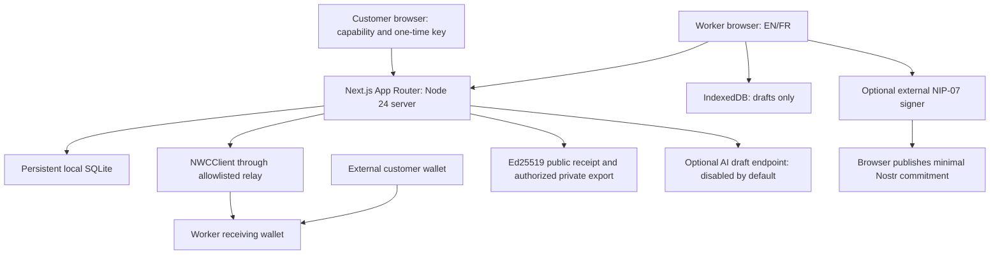

# Architecture

## Implemented Prototype

This describes the implemented single-host app, not a security certification. [VERIFICATION.md](VERIFICATION.md) records 122 passing tests, typecheck, a clean production build, the unpaid browser journey and offline reconnection. There have been 0 genuine wallet settlements and no external NIP-07 signing or relay publication. The original idea's Supabase option and default worker-signed receipt do not describe this implementation.

## Runtime And Storage

Next.js TypeScript App Router uses Node-runtime server handlers, not Edge. Node 24 built-in `node:sqlite` persists to `DB_PATH`, default `./data/jefpass.sqlite`. SQLite uses WAL, synchronous FULL, a busy timeout, parameterized queries, and synchronous `BEGIN IMMEDIATE` transactions. JSON documents and rate-limit records live in local tables. One process, one instance, durable writable volume; no serverless ephemeral filesystem, shared network-drive SQLite, or multi-replica promise. Long synchronous queries and document scans can block the process; capacity and restore drills remain unverified.

Server records include workers, per-password salted scrypt hashes, hashed session identifiers, hashed expiring customer capabilities, signed acknowledgements, payment reservations, wallet identity, and receipts. Sessions expire after 30 days; login/register replaces the presented session. Cookies are HttpOnly, SameSite=Strict, Secure when served over HTTPS. Mutations require matching Origin and `X-Jefpass: 1`, with Fetch Metadata checks; ownership checks and SQLite-backed rate limits guard API access. These controls are implemented, not externally audited.

Per-worker NWC URIs use AES-256-GCM with random 12-byte nonces; the key is outside SQLite. `APP_ENCRYPTION_KEY` optionally supplies exactly 32 bytes as hex/base64; otherwise a durable key is generated beside the database, default `data/key`. The current envelope does not provide worker-bound associated data or a versioned key-rotation system. Job details, SQLite WAL/journals, exports, and backups are not encrypted by this control. Use OS disk encryption, restrictive ACLs, and protected backups. Server compromise can expose decrypted credentials and issue false attestations.

Browser `idb-keyval` stores worker-scoped drafts and queued nonfinancial job creation. Each queued job retains a `clientId`; backend deduplication is scoped to worker plus client ID, returns the existing job on identical retry, and rejects changed terms under the same ID. Flush checks the signed-in owner before sending. This is not an encrypted vault or server backup. No payments or customer signatures are queued. Customer secret keys use `sessionStorage` keyed by `job.id`, separate from drafts. There is no service worker/offline app-shell reload guarantee; the manifest is an install hint only. Photos and upload endpoints are deferred.

## Routes

- `/` is the authenticated workbench; `/confirm/[token]` is customer review/signing, `/verify/[id]` is public receipt verification, and `/passport/[id]` lists explicitly shared completed work.
- `/api/session`, `/api/auth/register`, `/api/auth/login`, and `/api/auth/logout` handle session/account state; `/api/profile` updates the worker profile.
- `/api/jobs` creates/lists jobs; `/api/jobs/[id]` reads an owned job. POST actions include `share`, `complete`, `invoice`, `reconcile`, `receipt`, and `visibility`.
- `/api/customer/[token]` serves the capability-scoped review/challenge and accepts signed actions. `/api/wallet` connects/disconnects the encrypted wallet; `/api/export` is the authorized private export.
- `/api/receipts/[id]` serves public receipt/signature metadata; `/api/receipts/[id]/nostr` records a checked optional worker event. `/api/passport/[id]` serves shared work. `/api/ai/draft` provides optional reviewed drafts.

## Customer Acknowledgements

Capabilities have 256 bits of randomness; only hashes persist, with seven-day expiry. Generating a fresh share link replaces the prior token hash. Treat `/confirm/[token]` as a bearer secret and redact URLs in operator/proxy logs. API responses use a no-referrer policy. Customer accept, acknowledge, and dispute actions use signed kind-27235 Nostr events with job ID, canonical scope hash, action, and one-use nonce. Challenges expire in five minutes; event timestamps must also be within five minutes. Nonce consumption and state mutation occur in one transaction. Acceptance binds the customer's public key for later actions.

The browser refreshes the challenge and compares displayed scope/state before signing. The scope binds job/worker IDs, title, description, category, amount, currency, and due date. A stolen unbound link may be redeemed by an attacker; a technician can also impersonate a customer. Browser-key control is not identity verification. Closing/deleting the signing session can lose the key; later acknowledgement cannot silently substitute another key. There is no general account/key recovery flow for customers.

## Durable Payment Protocol

1. Authenticate worker and authorize job; freeze expected integer millisatoshis, selected network, worker wallet fingerprint, and operation ID.
2. In a transaction, reserve invoice creation before any network request; prevent competing requests for that job/operation. Persist a conservative unresolved state through crashes.
3. Call `NWCClient` once to request `make_invoice`. On response, use `bolt11` to verify signature, exact amount, configured network, expiry, and payment hash consistency before exposing it. Pin wallet identity; do not accept a hash just because it came in the response.
4. Persist validated invoice, hash, expiry, and operation link before presenting/polling. Customer pays independently; the server never calls a spending method.
5. Reconcile with `lookup_invoice` for the same invoice/hash and wallet. Require wallet-reported settlement, exact amount and hash consistency, and a valid 32-byte preimage with `SHA256(preimage) == payment_hash`. Only then persist `SETTLED` plus verification evidence atomically.
6. Timeouts, disconnects, or crashes after reservation leave `UNKNOWN`, not a retriable creation failure. If hash is known, repeat lookup only. If missing, block replacement creation and require operator/wallet reconciliation; there is no safe automatic retry by operation ID unless wallet semantics are actually proven.

The adapter implements these checks with `bolt11` and `NWCClient`; fixture tests do not establish live wallet interoperability. Wallet changes/disconnect are blocked while operations are unresolved. `LIGHTNING_NETWORK` defaults to `regtest`; `testnet`/`signet` require exact wallet `getInfo` network agreement because both share the `tb` invoice prefix. Mainnet is always rejected regardless of flags. Relay selection is exact parsed-URL matching against comma-separated `NWC_ALLOWED_RELAYS`; empty fails closed. Only WSS plus the operator allowlist restrict destinations, not a separate private-address filter.

Local expiry alone does not turn an accepted hold invoice into `EXPIRED`: it remains `PENDING` until wallet-reported terminal evidence. This unresolved hold-invoice behavior can block wallet changes. Late lookup allows the original expired invoice to be checked and still requires the exact preimage for settlement. Missing-hash ambiguity needs wallet/operator investigation; there is no automatic replacement or general manual-resolution UI.

The pinned `@getalby/sdk` 9.0.0 uses a required npm `postinstall` `patch-package` patch for null envelopes, method correlation and request cleanup. Both ESM/CJS paths are tested and patch reapplication passed. This does not rewrite NIP-47; do not skip the patch.

## Receipts And Independent Verification

Receipt version 1 uses recursive lexicographically sorted object keys, preserved array order, JSON strings/booleans/null, and safe integers only. Unsupported values are rejected. SHA-256 commits to the canonical UTF-8 payload; Ed25519 signs those same bytes. The public payload includes receipt/worker/job IDs, scope hash, amount/currency, service state, issue/completion/acknowledgement timestamps, issuer public key, and payment state, expected millisatoshis, hash, source, network, and verification/settlement timestamps. `preimageVerification` is `SHA256_MATCH` only for checked settled evidence, otherwise `NOT_VERIFIED`. No raw invoice/preimage or full acknowledgement event is in this public receipt.

A receipt can snapshot completed, acknowledged, or disputed work without a payment; receipt issuance is not settlement. The public browser recomputes the canonical commitment and verifies Ed25519 using Web Crypto, then compares the embedded key with the current installation issuer public key from `/api/session`. This is browser-side integrity checking with same-server issuer trust, not an independent key registry or wallet query. Optional attached Nostr events are checked separately. Do not label a server signature a worker signature.

Authorized `/api/export` includes private jobs, customer events, receipts, worker Nostr attachments, and stored invoice/preimage evidence. It excludes NWC secrets and capability hashes. `npm run verify:bundle -- path/to/private-export.json` checks signatures, scope, customer events and available BOLT11 amount/network/hash/preimage evidence outside the database. Independently pin `TRUSTED_ISSUER_PUBLIC_KEY` for issuer trust. This does not prove payer identity, repair quality or an honest issuer lookup timestamp; direct wallet lookup still requires authorized access.

NIP-07 signing/publication runs in the worker browser. Kind 30078 content is exactly canonical sorted `{commitment,receiptId}` with `tags: [["d", receiptId]]`; no full receipt, invoice, preimage, or customer data is published. No additional commitment salt is implemented. Relays see timing and worker identity and cannot guarantee deletion. Public receipts are accessible by receipt ID independently of passport visibility; do not treat unlisted as private. External signer/publication remain unexercised.

## Keys, Backups, And Rotation

- Issuer: an Ed25519 private key is generated durably beside `DB_PATH` (default `data/issuer-private.pem`). There are no supported receipt issuer environment variables. Losing/replacing it changes current-install issuer trust for old receipts. A historical key registry, managed rotation, and compromise notices are not implemented; distribute/pin public fingerprints separately for independent trust.
- NWC encryption: preserve the exact configured `APP_ENCRYPTION_KEY` or generated `data/key`. Rotation/migration is an operator task, not an implemented versioned key-management flow. Missing keys means lost connections. Revoke wallet delegations after suspected exposure; server-side deletion alone is insufficient.
- Backups: stop the app for a consistent database backup or use a supported SQLite online backup mechanism. Never copy a live database without WAL consistency. Encrypt backups and key recovery material, restrict access, and test restoration on an isolated instance. Restore the database and matching installation keys together before serving traffic; this drill has not been completed.
- Restart: unresolved reservations stay unresolved and reconcile by the original hash. Restore must not trigger `make_invoice` or publish private proof data automatically.
