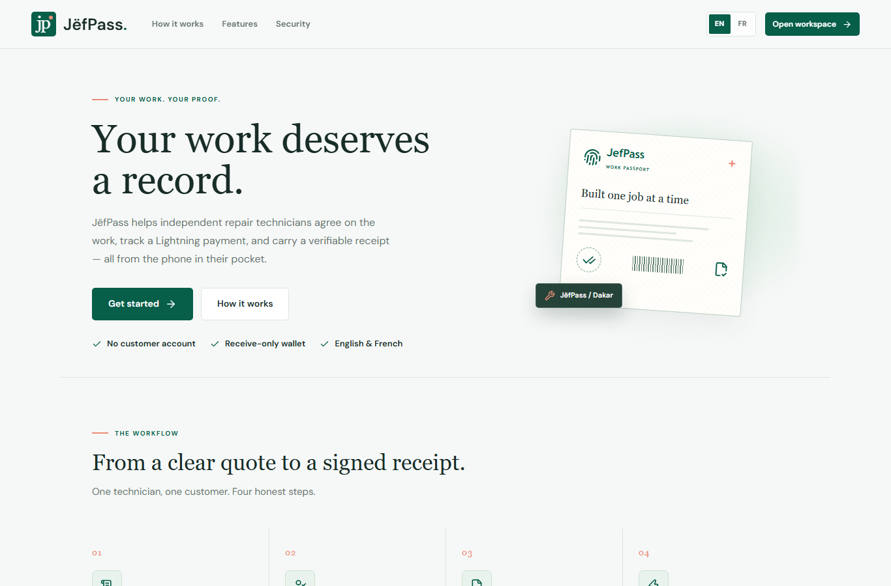
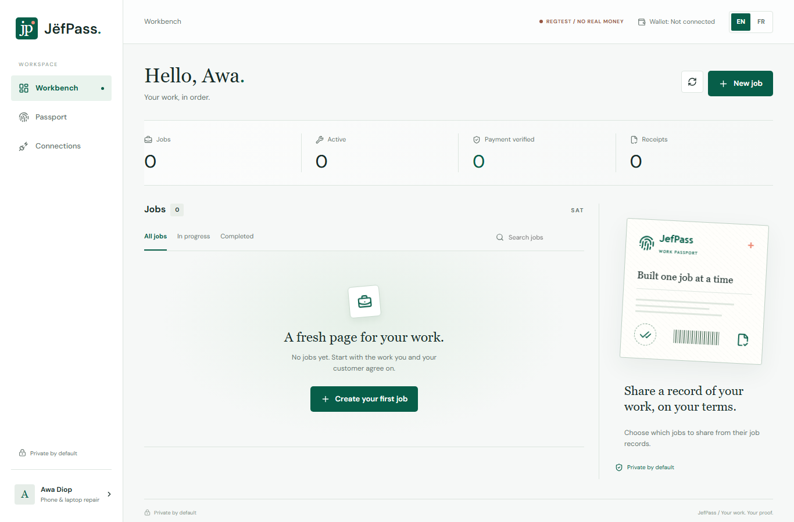
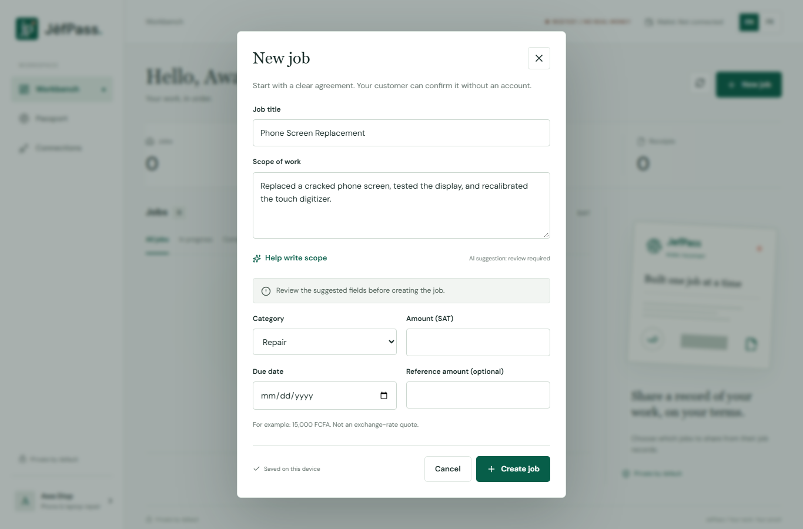
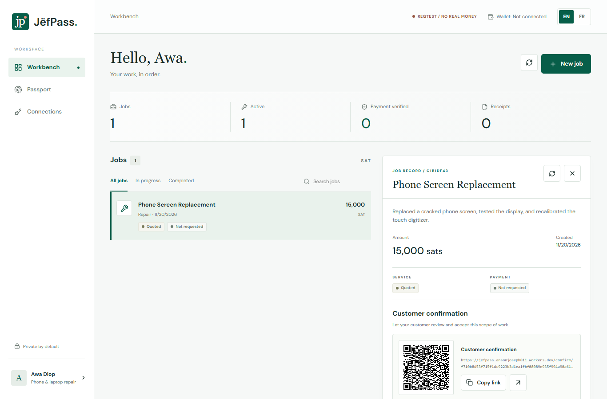
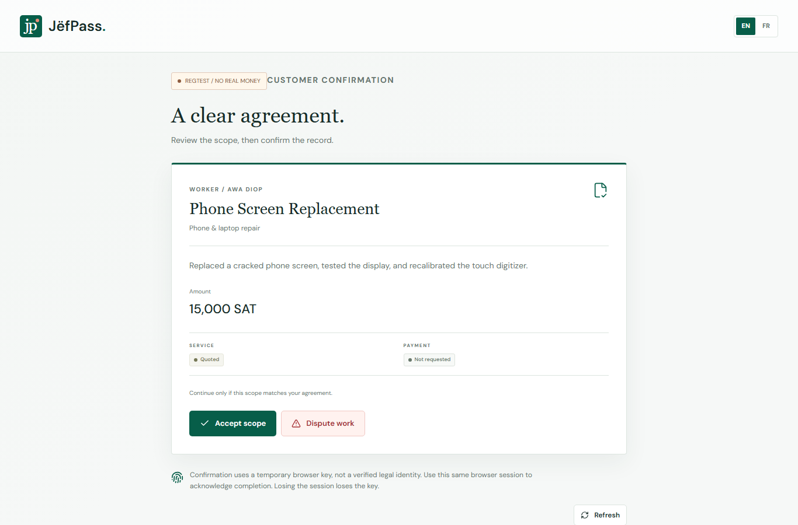
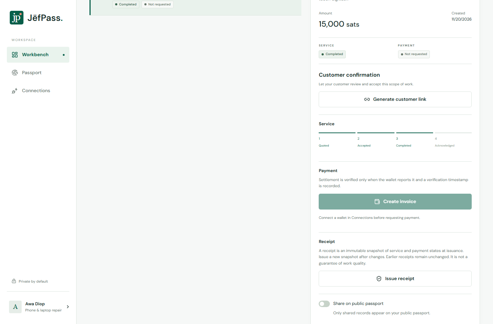
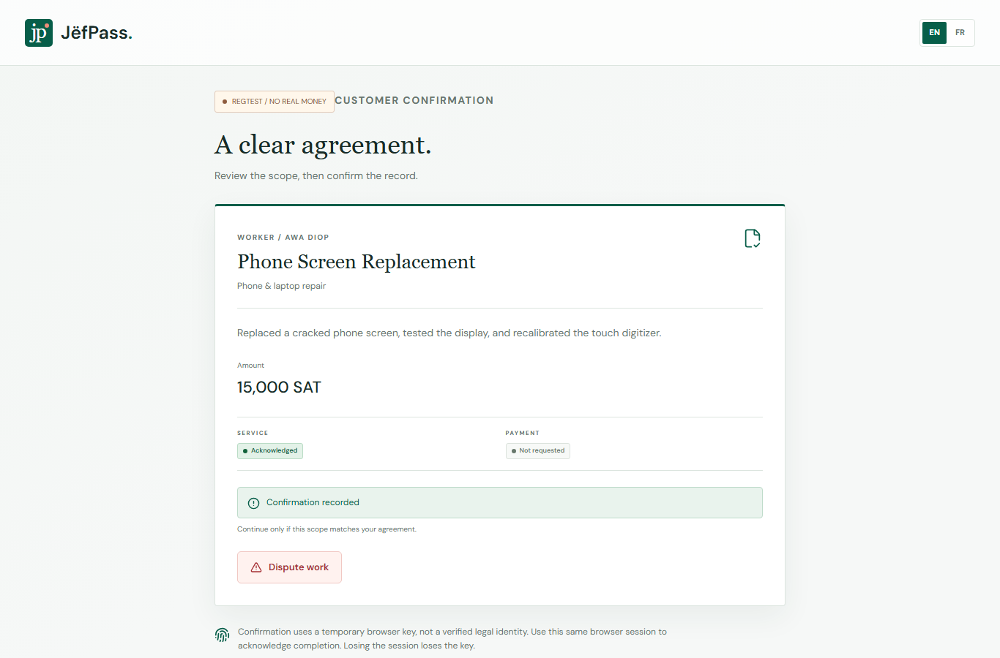
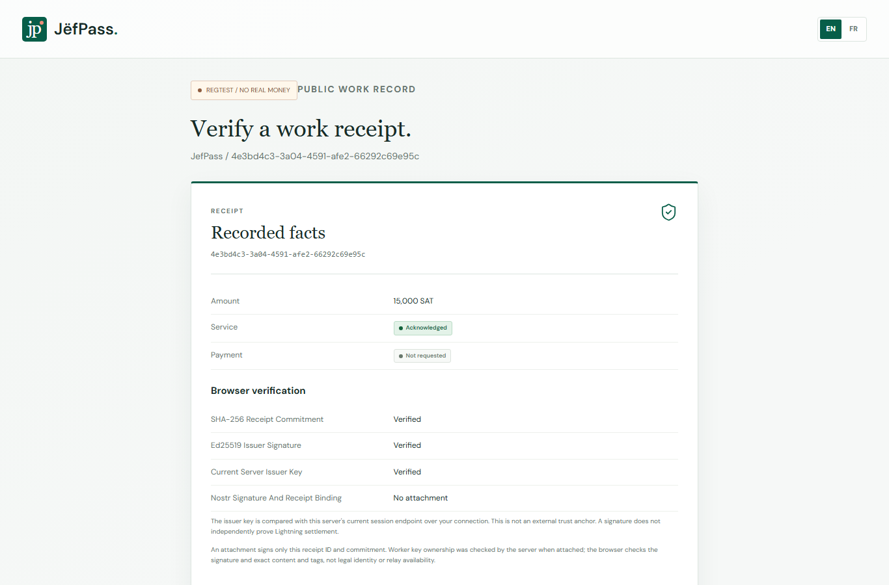
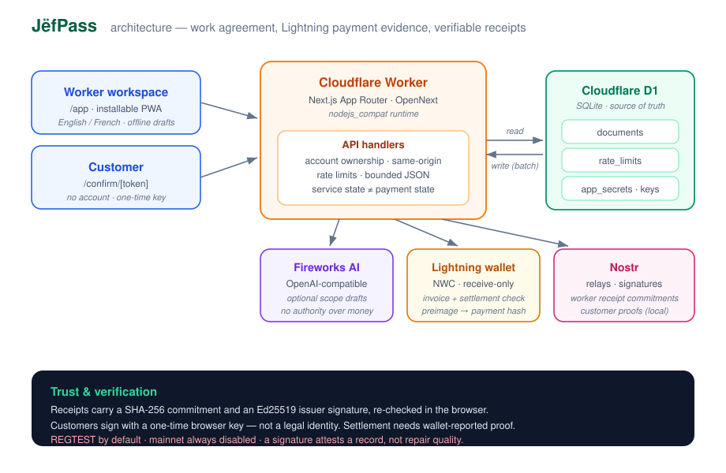

<div align="center">


# JëfPass

**Your work. Your proof.**

An open-source work-record and Lightning payment-evidence passport for independent repair technicians.
Agree a clear scope, record completion, verify an incoming Lightning payment, and keep a portable, signed receipt.

[](https://github.com/ansonj-dev/jefpass/actions/workflows/ci.yml)
[](LICENSE)
[](https://nextjs.org)
[](https://developers.cloudflare.com/workers/)
[](https://nodejs.org)

[Live demo](https://jefpass.ansonjoseph811.workers.dev) · [Screenshots](#screenshots) · [Architecture](#architecture) · [Trust &amp; verification](#trust--verification) · [Docs](#documentation)

</div>

---

## Overview

Independent technicians often stitch job records together from chat messages, paper notes and separate payment apps. Carrying a consistent record of the agreed work, the customer's acknowledgement and the payment evidence from one customer to the next is hard.

JëfPass explores one narrow workflow — a single technician and a single customer, starting with phone, laptop and small-appliance repairs. It keeps **service facts and payment facts separate**: a customer's acceptance does not prove the work was done, an acknowledgement does not prove a payment settled, and a receipt signature proves only that the issuer signed a specific record — not repair quality or legal identity.

> This is a working prototype built for the Dakar Bitcoin Hack 2026, not a production-certified financial service. The default network is **REGTEST — no real money** and mainnet is always disabled.

## Screenshots

<table>
  <tr>
    <td width="50%" align="center" valign="top">
      <br>
      <b>Landing</b><br>
      <sub>Bilingual landing page introducing the four-step workflow.</sub>
    </td>
    <td width="50%" align="center" valign="top">
      <br>
      <b>Workbench</b><br>
      <sub>Worker dashboard with jobs, separate service &amp; payment states, and stats.</sub>
    </td>
  </tr>
  <tr>
    <td width="50%" align="center" valign="top">
      <br>
      <b>AI scope assistant</b><br>
      <sub>Optional Fireworks assistant drafts a title, scope and category — the worker reviews before saving.</sub>
    </td>
    <td width="50%" align="center" valign="top">
      <br>
      <b>Shareable customer link</b><br>
      <sub>Every job produces an expiring link and QR code — the customer needs no account.</sub>
    </td>
  </tr>
  <tr>
    <td width="50%" align="center" valign="top">
      <br>
      <b>Customer confirmation</b><br>
      <sub>The customer reviews the exact scope and accepts (or disputes) it in their browser.</sub>
    </td>
    <td width="50%" align="center" valign="top">
      <br>
      <b>Completion</b><br>
      <sub>The worker records completion; service progress stays independent of payment.</sub>
    </td>
  </tr>
  <tr>
    <td width="50%" align="center" valign="top">
      <br>
      <b>Acknowledgement</b><br>
      <sub>The customer acknowledges the completed work with the same one-time browser key.</sub>
    </td>
    <td width="50%" align="center" valign="top">
      <br>
      <b>Verifiable receipt</b><br>
      <sub>A signed receipt checked in-browser: SHA-256 commitment and Ed25519 issuer signature verified.</sub>
    </td>
  </tr>
</table>

## Architecture

<p align="center">
  
</p>

- **Next.js App Router + TypeScript** run on **Cloudflare Workers** through the OpenNext adapter (`nodejs_compat`).
- API handlers enforce account ownership, same-origin mutations, bounded JSON input and rate limits.
- **Cloudflare D1** is the persistent source of truth (`documents`, `rate_limits`, `app_secrets`). Each request hydrates a request-scoped, in-memory compatibility database from D1 and commits queued writes atomically with a D1 batch — the non-functional Workers `node:sqlite` stub is never constructed. Local development uses Node 24 built-in SQLite on disk.
- Optional integrations: **Fireworks** (OpenAI-compatible) for scope drafting, a **receive-only NWC Lightning wallet** for invoices and settlement checks, and **Nostr** for receipt commitments and customer proofs.

See [docs/ARCHITECTURE.md](docs/ARCHITECTURE.md) for data flow, routes and state transitions, and [docs/CLOUDFLARE.md](docs/CLOUDFLARE.md) for the Workers/D1 deployment.

## How it works

1. **Quote** — the technician writes a scope, category, amount in sats and optional due date.
2. **Confirm** — the customer opens an expiring link, reviews the exact scope and signs acceptance in their browser; no account needed.
3. **Complete** — the technician records completion. The same customer session acknowledges the work or raises a dispute.
4. **Get paid, keep proof** — the technician requests an invoice from a receive-only wallet. Once the wallet reports settlement, JëfPass issues an immutable signed receipt that can stay private, be exported, or be shared on a public passport.

## Trust &amp; verification

Trust in JëfPass is deliberately narrow and checkable:

- **Service state is never merged with payment state.** Acceptance, completion and settlement are distinct layers, not a single checkmark.
- **Signed receipts.** Each receipt carries a canonical payload, a **SHA-256 commitment** and an **Ed25519 issuer signature**. The public verifier recomputes the commitment and checks the signature against the server's current issuer key. This is an integrity check, not an identity or payment oracle.
- **Customer proofs.** Customer actions are signed with a **one-time browser key** scoped to the job and bound to a single-use nonce. This proves control of a browser key, not a legal identity.
- **Payments.** NWC connections are **receive-only** and encrypted at rest (AES-256-GCM). A payment is marked `SETTLED` only when the wallet reports the incoming invoice settled and the returned preimage hashes to the original payment hash. Ambiguous outcomes stay `UNKNOWN` and are never silently retried.
- **AI has no authority.** The assistant only drafts text; it cannot approve work, sign receipts, set payment state or move funds.
- **Safe by default.** `REGTEST` network, mainnet disabled, high-entropy expiring links hashed at rest.

For independent checks, obtain the issuer public key through a trusted channel and verify an exported bundle offline:

```bash
npm run verify:bundle -- path/to/private-export.json
```

Full detail: [docs/THREAT_MODEL.md](docs/THREAT_MODEL.md) · [docs/VERIFICATION.md](docs/VERIFICATION.md) · [docs/LIMITATIONS.md](docs/LIMITATIONS.md).

## Why these protocols

| Technology | Purpose |
|---|---|
| Bitcoin Lightning | Creates incoming invoices and provides wallet-reported settlement evidence |
| Nostr Wallet Connect | Connects to a worker-controlled wallet through a dedicated, receive-only connection |
| Nostr events | Signs customer actions and, optionally, a worker-signed receipt commitment via a NIP-07 signer |
| SHA-256 + Ed25519 | Commits to and signs receipt content so tampering is detectable |
| Fireworks AI (optional) | Drafts job descriptions; no authority over consent, receipts or payments |
| IndexedDB | Saves non-financial job drafts locally and syncs them when connectivity returns |

## Quick start

**Requirements:** Node.js 24.x, npm, and a persistent writable data directory for local development.

```bash
npm ci
npm run dev -- --port 3100
```

Open <http://localhost:3100>. Use the committed lockfile; the SDK postinstall patch is required, so do not install with scripts disabled.

**Checks** (the same set runs in CI on pushes and pull requests):

```bash
npm test
npm run typecheck
npm run build
npm audit --omit=dev --audit-level=moderate
```

## Deploy to Cloudflare

The app targets Cloudflare Workers with a D1 database bound as `DB`.

```bash
npm run cf:build     # Next build + OpenNext bundle
npm run cf:migrate   # apply D1 migrations
npm run cf:deploy    # migrate + build + wrangler deploy
```

Set `APP_ORIGIN` to the exact HTTPS origin, keep the `DB` binding in `wrangler.jsonc`, and store the AI key as a Worker **secret** (never a plain variable). The encryption and Ed25519 issuer keys live in the private `app_secrets` D1 table. See [docs/CLOUDFLARE.md](docs/CLOUDFLARE.md).

### Environment

Start from [.env.example](.env.example).

| Variable | Purpose |
|---|---|
| `DB_PATH` | Local SQLite path; defaults to `./data/jefpass.sqlite` |
| `APP_ORIGIN` | Exact browser-facing origin. Required in production and must use HTTPS |
| `APP_ENCRYPTION_KEY` | Optional 32-byte key (64 hex or base64). If unset, a key is generated locally, or stored in the D1 `app_secrets` table on Cloudflare |
| `LIGHTNING_NETWORK` | `regtest` by default; `testnet`/`signet` when the wallet matches. Mainnet is disabled |
| `NWC_ALLOWED_RELAYS` | Exact comma-separated WSS relay allowlist. Empty fails closed |
| `NEXT_PUBLIC_NOSTR_RELAYS` | Optional public relay list for worker commitment publication |
| `AI_ENABLED` | Must be `true` before any provider call is made |
| `AI_API_KEY` | Server-side provider bearer token (e.g. a Fireworks key). Legacy alias: `OPENAI_API_KEY` |
| `AI_BASE_URL` | OpenAI-compatible endpoint. Default `https://api.openai.com/v1`; Fireworks: `https://api.fireworks.ai/inference/v1` |
| `AI_MODEL` | Model id (e.g. `accounts/fireworks/models/gpt-oss-120b`). Legacy alias: `OPENAI_MODEL` |
| `JEFPASS_CLOUDFLARE` | `true` in the Worker; requires the `DB` D1 binding |

## Project structure

```
app/            Next.js App Router routes (/, /app, /confirm, /verify, /passport, /api)
components/     Client UI (auth, workbench, job editor/detail, public views)
lib/            Server logic: db (SQLite + D1 adapter), auth, receipts, Lightning/NWC, AI, i18n
migrations/     D1 schema
docs/           Architecture, Cloudflare, threat model, verification and other references
scripts/        Demo seed and bundle verifier
tests/          Vitest suites (backend, Lightning, states, workflow guards, D1)
worker.js       Cloudflare entry wrapper that exposes the D1 binding to the app
wrangler.jsonc  Worker configuration (bindings, vars, D1)
```

## Status &amp; limitations

- Account, job lifecycle, customer confirmation, public passport, receipt signing, browser verification, private export and the NWC adapter are implemented and unit-tested.
- The NWC adapter has tests for invoice validation, exact amounts, network checks, payment-hash matching, preimage verification and uncertain outcomes — but **genuine external wallet settlements and live relay publication have not been demonstrated** in the recorded evidence.
- No user interviews, adoption metrics or field pilot are claimed. Never present a fixture, seeded record or screenshot as a real payment.

## Documentation

| Document | Contents |
|---|---|
| [ARCHITECTURE.md](docs/ARCHITECTURE.md) | Components, API routes and state transitions |
| [CLOUDFLARE.md](docs/CLOUDFLARE.md) | Workers, OpenNext, D1 schema, bindings and deployment |
| [INTEGRATIONS.md](docs/INTEGRATIONS.md) | Lightning, Nostr, AI and offline contracts |
| [THREAT_MODEL.md](docs/THREAT_MODEL.md) | Threats, controls and residual risk |
| [VERIFICATION.md](docs/VERIFICATION.md) | Automated and manual evidence |
| [LIMITATIONS.md](docs/LIMITATIONS.md) | Current boundaries |
| [DEMO_GUIDE.md](docs/DEMO_GUIDE.md) | Safe, repeatable demonstration |
| [PROJECT_BRIEF.md](docs/PROJECT_BRIEF.md) | Product hypothesis and judging-criteria mapping |

## License

[MIT](LICENSE). Contributions should preserve the separation between service state and payment state, and must never weaken the conservative `UNKNOWN` handling.
