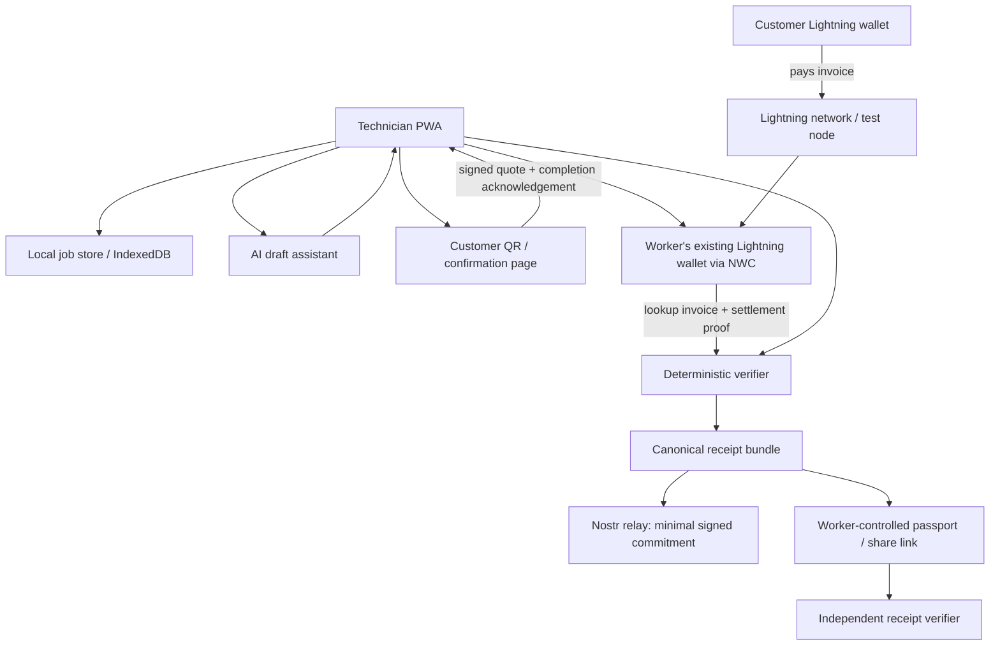

# JëfPass — The Work Passport That Belongs to the Worker

**Dakar Bitcoin Hack 2026 — Project formation and build brief**  
**Working name:** JëfPass  
**Tagline:** *Your work. Your proof.*  
**Category:** Bitcoin / Lightning + Nostr + practical AI  
**First user:** Independent repair technicians in Dakar, starting with phone and small-appliance repair workers  
**MVP principle:** One completed job becomes one portable, customer-acknowledged proof record—with real Lightning payment verification when Lightning is used.

> **The pitch in one sentence:** JëfPass gives independent technicians a portable work passport: every job can produce a customer-confirmed service record and, when paid through Lightning, independently verifiable payment evidence—without giving JëfPass custody of the worker's money or ownership of their work history.

---

## 1. The idea

JëfPass is an **offline-first proof-of-service passport** for independent workers. It is not a jobs marketplace, POS system, escrow platform or generic wallet.

A technician creates a simple job card, shares it with the customer, records the agreed scope and price, and obtains the customer's confirmation. When the work is complete, the customer can acknowledge that the service was received. If the customer pays through Lightning, JëfPass connects to the technician's own wallet, creates an invoice, checks the wallet's settlement result and verifies the payment preimage against the invoice payment hash. The final proof bundle is signed, exportable and attached to the worker's portable JëfPass profile.

The worker keeps the record. The worker chooses which records to share. There is no platform-controlled public rating score, no requirement for customers to create accounts, and no AI decision about whether work is genuine or money has been paid.

### The memorable product moment

A repair technician finishes a phone repair. The customer scans a QR code, confirms the recorded service, and pays the exact Lightning invoice. The technician's phone briefly loses connectivity. When it reconnects, JëfPass checks the **same invoice** instead of creating another one. It verifies the settlement proof and produces a shareable receipt. The technician's work passport now contains a signed record that can be shared with the next customer, a trade association or a future partner.

**The story is not “we put a repair shop on blockchain.” The story is “a worker's proof of work and payment can travel with them.”**

---

## 2. Why this is a stronger opening than another wallet or POS

The competitor audit found strong projects in merchant POS, sales books, group savings, conditional funding, delivery escrow, wallet education and AI wallet assistance. Rebuilding one of those categories would place JëfPass directly beside established entries.

The less crowded opening is the **individual worker's portable record of completed service jobs**. The unit of value is not a shop sale, a savings contribution or a project milestone. It is a single service job that both parties can acknowledge, with a verifiable payment record where Lightning is used.

### Research signal

- A January 2026 labour-market diagnostic prepared by Senegal's Ministry of Employment and the ANSD reports that informal employment represented **91.1% of jobs nationally in 2024** and **84.1% in Dakar**. The same report says skilled industry and artisan occupations represented **28.1% of employment in 2024**. These figures make independent skilled workers a material audience; they do not establish that all workers lack digital work records.
- The ILO's June 2025 Senegal case study describes the informal economy as approximately **97% of economic units** and about **96.4% of the workforce**, and explains that informality can constrain access to social protection, credit and formal business networks.
- The specific product hypothesis to validate is: *some independent technicians have difficulty assembling a trusted, portable history of jobs, customer acceptance and payment evidence when approaching new customers or organisations.* That hypothesis needs short interviews; it must not be presented as a measured national finding.

### Why the first market is repair work

Repair jobs naturally have a simple lifecycle: issue reported → scope and price agreed → work performed → customer accepts or requests a correction → payment recorded. That creates a useful proof record without requiring JëfPass to become a full marketplace or accounting product.

Start with independent phone and small-appliance repair technicians. This is a deliberately narrow first workflow, not a claim that every Senegalese informal worker behaves the same way.

---

## 3. The user and the problem

### Primary persona

**Independent repair technician** who finds customers through referrals, walk-ins, WhatsApp or local relationships. They may work alone or from a small workshop. They need to record what a customer requested, what was agreed, what was completed and whether payment was received.

### Secondary persona

**Customer** who wants a clear quote, proof of what was agreed, confirmation that the work was received, and a receipt they can keep. The customer should not need to install an app or create an account to confirm a job.

### The current-workflow hypothesis

A job record may be spread across a phone call, a WhatsApp conversation, a paper note, a payment message and the technician's memory. If a customer returns, disputes the price, requests a repeat service or asks for a receipt, reconstructing the history can be awkward. A technician changing phones or trying to demonstrate past work may have no single exportable record.

**Do not claim this as established fact until it is tested.** Conduct 3–5 short conversations with technicians and 2–3 customers. Ask them to show how they currently record a repair, quote, completion and payment. Do not lead them by asking whether they want blockchain.

---

## 4. What JëfPass actually does

### The five-step job lifecycle

1. **Create a job card.** The technician enters a service category, short description, quoted amount, optional parts/labour breakdown and an optional due date. AI can turn a voice note into a draft; the technician must review it.
2. **Customer confirms the quote.** The customer scans a QR or opens a short link. They see the exact scope and amount and confirm or reject it. No customer account is required.
3. **Technician records completion.** The technician marks the work complete and may attach an optional evidence photo. The app stores a hash commitment to the evidence; it does not claim that a photo proves the repair was performed correctly.
4. **Customer acknowledges receipt.** The customer scans again and selects “Received” or “Needs correction”. Their acknowledgement is signed and linked to the job record. It proves that the customer-controlled session acknowledged the record; it does not establish a government-verified identity.
5. **Payment is recorded honestly.** For Lightning, the technician creates an invoice through their connected wallet; the customer pays from their own compatible wallet; JëfPass checks the same invoice and verifies settlement evidence. Cash or mobile-money payments may be recorded as *two-party attested* only; they are not called provider-verified unless a real provider integration is implemented and checked.

### What the technician receives

- A job history with separate service and payment statuses.
- A signed receipt for each job.
- A QR code / share link for a selected receipt.
- A portable export of the proof bundle.
- A worker passport that lists only the records the worker chooses to disclose.

### What the customer receives

- The agreed scope and price before work starts.
- A clear record of what was marked complete.
- A receipt with an unambiguous payment status.
- A way to verify the receipt later without trusting a green tick on the technician's screen.

### What JëfPass deliberately does not do

- It does not match customers with workers or rank workers.
- It does not hold money, run escrow or promise refunds.
- It does not convert Bitcoin into XOF or provide mobile-money cash-out.
- It does not claim to verify the physical quality of a repair.
- It does not issue a credit score or guarantee access to loans.
- It does not allow AI to approve jobs, certify completion or authorize payments.
- It does not pretend that offline mode can settle a Lightning payment.

---

## 5. The three evidence layers

This is the centre of the product. Keep the evidence labels distinct and visible.

| Evidence layer | What is recorded | What it proves | What it does not prove |
|---|---|---|---|
| **Agreement** | Scope, quote, timestamp, worker signature, customer acknowledgement | Both signing keys acknowledged the displayed job terms | That either key represents a legally verified identity |
| **Service receipt** | Completion statement, customer “received” or “needs correction” response, optional evidence-file hash | The technician recorded completion and the customer session acknowledged the receipt state | That the work is objectively perfect or that a photo is truthful |
| **Payment proof** | Invoice, exact amount, payment hash, wallet lookup result, settlement time and preimage verification result | The connected Lightning wallet reported settlement and the preimage matches the invoice payment hash | That cash or mobile money was transferred, or that the customer received fiat value |

### Payment status vocabulary

Use explicit labels, never one generic green “Paid” badge:

- `NOT_REQUESTED` — no payment request exists.
- `INVOICE_OPEN` — invoice created; settlement not yet verified.
- `LIGHTNING_VERIFIED` — wallet lookup reports settlement and the preimage hash matches the invoice payment hash.
- `CUSTOMER_ATTESTED` — customer and worker have acknowledged a cash/mobile-money payment, but no provider settlement was independently checked.
- `UNDERPAID` / `OVERPAID` — amount does not match the agreed invoice or amount due; keep it visible for reconciliation.
- `EXPIRED` — invoice expired without verified settlement.
- `UNKNOWN` — the request timed out or the wallet result is ambiguous. Keep the same invoice/payment hash and reconcile it; do not blindly create or send another payment.
- `DISPUTED` — one party has added a signed dispute or correction request.

Service status and payment status must be separate. A job can be completed but unpaid, or paid while the service receipt is disputed.

---

## 6. Why Bitcoin, Lightning, Nostr and AI are essential here

### Lightning — evidence of value transfer

A normal database can store “paid”. JëfPass instead connects to the technician's existing Lightning wallet through Nostr Wallet Connect (NWC / NIP-47), requests only the receiving and lookup capabilities needed, creates a real invoice and checks the authoritative wallet result. When available, the returned preimage is hashed and compared to the invoice payment hash. The app does not store a seed phrase and does not become the custodian of the technician's funds.

A test-network or Regtest payment is acceptable for the hackathon demo if it is a genuine payment in that environment and is labelled clearly. It must never be presented as a mainnet payment or as merchant adoption.

### Nostr — a portable signed work record

The worker's Nostr identity signs the receipt commitment. A customer confirmation can be represented by a separate one-time signing key generated in the customer's browser, so the customer does not need a Nostr account. Where a customer already has a Nostr signer, it can be used instead.

Publish only a minimal event or commitment to Nostr relays. Names, telephone numbers, exact addresses, customer notes and raw photos remain private/off-relay. The worker can export the complete receipt bundle and verify the signatures and hashes independently.

### AI — reduce data-entry friction, not make trust decisions

The AI assistant turns a short voice note into a **draft** job description, service category, parts/labour notes and customer-facing summary. The technician reviews and confirms every field before the quote is shared. AI may help translate the summary into the chosen interface language. AI cannot set the payment state, sign the receipt, invent missing information, decide whether the customer is satisfied or spend funds.

For the deadline MVP, ship one narrow AI task: voice/text note → structured job draft. Start with French/English. Treat Wolof voice support as an experiment that requires native-speaker review; do not advertise reliable Wolof transcription until tested.

### Offline-first behaviour — honest, not magical

The PWA can save a draft job and queue non-financial updates in IndexedDB while offline. It shows `PENDING SYNC`. It cannot create a verified Lightning payment without network access, and it cannot label an offline record as settled. After reconnection, it syncs and reconciles the same job/invoice identifiers.

---

## 7. What makes JëfPass different from the audited field

| Competitor group | What it already does well | JëfPass's distinct job |
|---|---|---|
| **Caisse Teranga** | Low-bandwidth merchant POS, FCFA-first checkout, sales ledger, Lightning/NWC path | A portable, worker-owned history of individual service jobs with customer co-acknowledgement; not a shop cashier |
| **Jaay** | Merchant cashbook, customer debt, WhatsApp, payment links and sales history | A job-by-job agreement/completion receipt and shareable work passport, not another merchant ledger |
| **SamaBoutik** | Shop inventory, sales, profit and payment methods | No inventory or shop management; one service job and its evidence |
| **FlashDrop** | Hold-invoice payment-on-delivery workflow for buyer, seller and courier | No escrow or delivery orchestration; records service acceptance and portable worker history |
| **NobPay** | Milestone funding, evidence uploads, witnesses and payment dossier | No project funding or release governance; a much lighter customer-technician service record |
| **GreyFinance** | Team budgets, approvals, roles and payment reconciliation | Independent worker's service evidence, not internal company treasury |
| **Natt / CircleSats / Twese** | Group contributions, savings rounds and payout coordination | Individual service work, not pooled savings or payouts |
| **SatsClass / Satacademy** | Practical wallet learning | A productive daily workflow, not education |
| **SatsFlow / SatsGuard AI** | Ambitious Lightning/AI automation claims | Use maintained libraries and real wallet responses; never simulate settlement or mint a fake preimage |

The audited field review covered 17 GitHub repositories across 16 code-backed products, with some additional submissions assessed from descriptions only. The accessible gallery exposed 24 of 37 submissions and seven more indexed projects; 13 gallery entries remained inaccessible. Therefore, JëfPass is a **research-backed gap in the available field**, not a claim that no other entrant anywhere has a similar feature.

---

## 8. The MVP that can actually be built

### P0 — must work before submission

1. **Worker passport:** create a worker profile with a Nostr public key; no public personal phone/address by default.
2. **New job:** create a service job with a short scope, price, currency note, timestamp and unique job ID.
3. **Customer quote confirmation:** QR/link page showing the scope and price; customer accepts or rejects; store a signed one-time acknowledgement.
4. **Completion acknowledgement:** technician marks complete; customer confirms receipt or requests correction.
5. **Lightning receive flow:** connect a compatible NWC wallet; create invoice; show QR; check invoice status; verify exact payment hash/preimage; persist the result.
6. **Proof receipt:** construct a canonical receipt, sign it, publish a minimal Nostr commitment, and make a public verification page or downloadable JSON bundle.
7. **Status safety:** exact amount checks, `UNKNOWN` handling, idempotent reconciliation and no blind retry.
8. **Mobile PWA:** clear, usable on a phone-sized screen; French-first or bilingual French/English labels; low payload and large controls.
9. **Honest demo mode:** network and test status are visible at all times; no “simulate paid” action in the real wallet path.

### P1 — only after the complete P0 path works

- Voice note → AI-generated draft job card, with worker review.
- Optional photo attachment with SHA-256 commitment; raw image not published to Nostr.
- Offline draft queue in IndexedDB and clear pending-sync banner.
- JSON export/import for worker portability.

### P2 — explicitly future work

- Native Wolof voice UX after native-speaker validation.
- Trade-association or cooperative verification workflows.
- A partner-facing consent-based proof view for training or finance organisations.
- Optional verified provider integrations for mobile-money evidence.
- Multi-worker workshop accounts and business analytics.

### Features to refuse for this hackathon

No job marketplace, public star ratings, public leaderboards, NFT/SBT collection, custom token, escrow/hold invoices, lending, insurance, fiat exchange, automatic Mobile Money, USSD, custom BOLT11 implementation, custom NWC cryptography, or autonomous payment agent. Each one increases scope and weakens the core demo.

---

## 9. Recommended implementation architecture

Keep the app deliberately small. A practical stack is:

- **Frontend:** Next.js + TypeScript + Tailwind, mobile-first PWA.
- **Offline data:** IndexedDB (Dexie or equivalent) for job drafts, sync queue and local proof bundles.
- **Lightning:** NWC / NIP-47 through a maintained SDK or library. Request only the wallet methods needed for receiving and invoice lookup. Never ask for a seed phrase.
- **Nostr:** `nostr-tools` or a maintained Nostr SDK for event construction, event verification and relay publishing. Prefer a NIP-07 external signer for the worker key. Customer acknowledgement uses a one-time key in the browser, with the limitation clearly labelled.
- **AI:** one server-side structured-output endpoint for voice/text-to-job-draft. Keep the API key on the server. Pass only the job description, not wallet secrets or customer PII.
- **Backend:** keep as thin as possible. If persistence is required, use Supabase/Postgres for encrypted/private records and event references; do not store NWC credentials in plaintext. The local-first MVP can avoid a large backend.
- **Verification:** a small deterministic verifier module that checks canonical record hash, Nostr event IDs/signatures, customer acknowledgement signature, Lightning invoice hash, exact amount and preimage hash.

### High-level architecture



### Data boundaries

- **Private/local:** customer contact details, full job notes, raw photos, private quote details when not shared, local encryption key.
- **Signed receipt bundle:** scope and price as shared by both parties, state transitions, signatures, payment evidence where consented, network and timestamp.
- **Public Nostr event:** only the minimum commitment and public worker identity needed for independent lookup; no raw customer PII or photo.
- **Never in app storage:** wallet seed phrase, private key from the user's Lightning wallet, plaintext NWC URI in source code/localStorage, AI provider secret.

### Suggested receipt schema

```json
{
  "schema": "jefpass.receipt.v1",
  "job_id": "uuid",
  "worker_pubkey": "nostr-public-key",
  "service_category": "phone-repair",
  "scope_hash": "sha256:...",
  "agreed_amount": {
    "currency": "XOF",
    "amount": 12000
  },
  "timestamps": {
    "quoted_at": "ISO-8601",
    "accepted_at": "ISO-8601",
    "completed_at": "ISO-8601",
    "customer_received_at": "ISO-8601"
  },
  "service_status": "CUSTOMER_ACKNOWLEDGED",
  "payment": {
    "method": "LIGHTNING",
    "network": "MUTINYNET_OR_REGTEST",
    "invoice": "bolt11-invoice",
    "payment_hash": "hex",
    "amount_msat": 1000000,
    "status": "LIGHTNING_VERIFIED",
    "preimage_verification": "SHA256_MATCH"
  },
  "worker_signature_event_id": "nostr-event-id",
  "customer_ack_event_id": "nostr-event-id-or-one-time-signature",
  "evidence_commitments": [],
  "record_commitment": "sha256:..."
}
```

**Schema caution:** the example uses illustrative values only. The canonical `scope_hash` and `record_commitment` must be computed from a stable, documented serialization. Do not publish the complete JSON publicly by default. Do not hardcode the sample invoice, amount or network as production values.

### Critical payment verification sequence

1. Decode the invoice with a maintained BOLT11 library; reject invalid invoices, unsupported networks, missing amounts and expired invoices.
2. Request invoice creation from the worker's connected NWC wallet; persist the job ID, invoice/payment hash and expected amount before polling.
3. Customer pays from a separate Lightning wallet.
4. Query `lookup_invoice` for the **same invoice/payment hash**.
5. Require the wallet to report settlement and return a preimage.
6. Verify `SHA256(preimage) == payment_hash` and the amount matches exactly.
7. Mark `LIGHTNING_VERIFIED` only after all checks pass.
8. On timeout or lost response, mark `UNKNOWN`, keep the invoice record and query it again. Never create a replacement invoice or submit a second payment automatically while the first result is unknown.

If the selected NWC wallet does not support the required methods or test network, use a genuine LND/Core Lightning Regtest adapter for the demo. Do not quietly swap in a mock that returns `SETTLED`.

---

## 10. Security and trust model

### Assets to protect

Worker's Nostr signing ability, NWC connection credential, private customer information, job evidence, receipt integrity, payment status and worker's ability to export their history.

### Main threats and controls

| Threat | Control |
|---|---|
| Fake “paid” status from frontend or AI | Only deterministic wallet lookup + exact invoice/preimage verification can set `LIGHTNING_VERIFIED` |
| Duplicate payment after timeout | Persist invoice/payment hash; `UNKNOWN` state; query original invoice; idempotency key on job + payment hash |
| Underpayment marked complete | Exact amount matching; separate underpaid/overpaid states; no percentage tolerance |
| Worker fabricates customer acceptance | Customer confirmation on their own device/session with a one-time signing key; label it as a session acknowledgement, not verified legal identity |
| Customer denies or changes job later | Append-only signed correction/dispute events; never silently edit the original signed receipt |
| NWC credential theft | Least-privilege NWC connection, no seed phrase, keep URI out of source/localStorage/logs, allow disconnect/revoke, short-lived in-memory session where possible |
| PII leaked to Nostr | Publish only salted commitments/minimal metadata; private payload stays encrypted/off-relay; worker controls sharing |
| Malicious or manipulated photo | Photo is optional; hash proves file consistency after commitment, not truth or physical location |
| AI prompt injection or hallucinated fields | Strict schema, source text retained, worker must review; AI cannot sign, verify payment or change status |
| Relay outage or poor connection | Local queue, multiple relay option, visible `PENDING SYNC`; never mark relay publication as payment settlement |

### Trust statements to place in the UI and README

- A Nostr signature proves that a key signed a record, not that a government verified the person's identity.
- A customer signature proves acknowledgement by that signing session, not the customer's legal identity.
- A hash proves that a file or record matches a prior commitment, not that the content is truthful.
- A Lightning preimage matched to an invoice payment hash is evidence of that Lightning payment's settlement; it is not proof of cash-out or fiat receipt.
- Cash/mobile-money acknowledgements are not provider-verified without a real provider API and verified provider response.

---

## 11. Five tests that matter more than a huge test count

1. **Happy path:** create job → customer accepts quote → technician completes → customer acknowledges → create Lightning invoice → external test wallet pays → wallet lookup reports settled → preimage hash matches → verifier accepts the receipt.
2. **Wrong amount:** a receipt with a mismatched expected amount is rejected and cannot become `LIGHTNING_VERIFIED`.
3. **Tampering:** change the service scope, amount or timestamp after signing; signature/commitment verification fails.
4. **Ambiguous timeout:** wallet lookup times out after a payment attempt; state becomes `UNKNOWN`; retry checks the same invoice and never sends another payment automatically.
5. **Privacy/authorization:** a public Nostr event contains no customer name, phone, address, raw image or NWC secret; one worker cannot access another worker's private records.

Add one test for duplicate invoice event processing and one for invalid/expired BOLT11 if time permits.

---

## 12. The judge demo: a three-minute story

### Demo preparation

- A technician account with a dedicated test Nostr identity.
- A connected NWC test wallet or local Regtest Lightning wallet.
- A separate customer test wallet with enough test sats.
- One seeded job for visual context, clearly marked `DEMO SEED`.
- Browser with customer confirmation page ready.
- A network label always visible: `MUTINYNET TEST` or `REGTEST — NO REAL MONEY`.

### Three-minute run of show

| Time | What to show | What the judge should understand |
|---|---|---|
| 0:00–0:25 | Technician profile and the problem | A skilled worker needs portable proof of jobs, acceptance and payment—not another wallet dashboard |
| 0:25–0:55 | Create “phone charging-port repair”, show scope and quote, generate customer QR | The job agreement is readable and customer confirmation needs no account |
| 0:55–1:20 | Customer opens QR, accepts quote, then acknowledges completion | Two parties contribute distinct signed statements; service and payment are separate states |
| 1:20–2:05 | Create invoice, pay from separate test wallet, query wallet, show preimage/hash match | This is a real Lightning test payment, not a button that invents `SETTLED` |
| 2:05–2:35 | Open receipt verifier and worker passport | The receipt can be checked and shared; worker owns the record |
| 2:35–3:00 | Show privacy boundary and honest limitations; include the AI draft only if that P1 feature is already working | AI saves typing; it does not decide truth or move money; no custody or fake fiat integration |

### The three sentences to say during the demo

1. “JëfPass is not another marketplace that owns a worker's customer history. It gives the worker a portable record they control.”
2. “The customer confirms the job, and Lightning settlement is verified against the invoice's payment hash—not a frontend success message.”
3. “We keep private details off public relays, and we label test payments, customer attestations and verified wallet settlement differently.”

---

## 13. How it maps to the five judging criteria

| Official criterion | JëfPass evidence to show | What would make the score weak |
|---|---|---|
| **Usefulness & Local Impact** | Narrow repair-technician persona; job agreement → completion → receipt workflow; Senegal labour-market context; 3–5 short user interviews or a candid statement that these are next steps | Pitching “all Africans” or claiming access to finance without partner evidence |
| **Security by Design** | No seed custody; minimal NWC permissions; exact invoice/preimage verification; `UNKNOWN` reconciliation; signed records; private data off-relay; threat model and five tests | Any fake settlement path, exposed NWC URI, public customer PII or automatic retry on timeout |
| **UX/UI Quality** | Mobile PWA; QR customer flow without registration; short plain-language forms; French-first labels; low-data screens; pending-sync state | Desktop-first admin dashboard, jargon, complex sign-up or confusing paid states |
| **Working MVP** | End-to-end quote, two-party confirmation, actual test Lightning invoice settlement and verifiable receipt; one-command run; seed data | Demo-only UI or a mock function returning `SETTLED` |
| **Clear Pitch & Docs** | This one-sentence value proposition, architecture diagram, setup, network labels, test results, limitations and 3-minute recording | Long feature list, unsupported adoption claims or no reproduction steps |

Do not promise a perfect score. The idea only earns this advantage if the working prototype proves the claims.

---

## 14. What to measure

For the hackathon, report measured demo results, not projected market size:

- Number of complete job records created.
- Number and percentage with both worker and customer acknowledgement.
- Number of Lightning invoices actually settled in the test environment.
- Number of receipts accepted by the independent verifier.
- Median time from job creation to receipt generation.
- Number of records successfully recovered after offline/reconnect.
- Number of issues found in short technician/customer usability tests.

### First validation script

Ask a technician:

1. “Show me how you currently record a customer's repair request and agreed price.”
2. “How do you prove what you repaired if the customer returns a week later?”
3. “How do you give a receipt today? What happens if you change phones?”
4. “Have you ever needed to show past work to a new customer, association or potential partner? What did you show?”
5. “Which part of this screen would you not use or trust?”

Ask a customer:

1. “What do you normally receive when you pay for a repair?”
2. “Would you scan a QR to confirm the agreed work and keep a receipt? Why or why not?”
3. “What information should never appear on a public worker profile?”

Do not count a positive response as product-market fit. Record exact feedback and the sample size.

---

## 15. Build sequence for the remaining deadline window

The official deadline in the research pack is **20 November 2026 at 20:00 UTC**. At the time this idea was drafted on 19 November, the remaining build window was roughly 37 hours. The sequence below is intentionally ruthless.

### Phase A — prove the risky integrations first

- Scaffold the PWA and create a blank receipt verifier.
- Connect one actual NWC wallet or local Regtest node.
- Create one invoice, pay it externally and confirm settlement by lookup/preimage.
- Sign and verify one Nostr event.
- If either critical integration fails, resolve it before building the rest of the interface.

### Phase B — complete the core user journey

- Job card form and worker profile.
- Customer quote QR page.
- Customer completion acknowledgement.
- Separate service/payment state machines.
- Receipt bundle and independent verification page.

### Phase C — make it feel like a product

- Mobile layouts, loading and error states.
- French-first plain language; English toggle if it is quick.
- Clear network/test labels.
- Local draft queue and reconnect status.
- AI voice/text-to-job draft only if the core journey is already working.

### Phase D — judge readiness

- Run the five critical tests.
- Add `README.md`, `PROJECT_BRIEF.md`, `ARCHITECTURE.md`, `THREAT_MODEL.md`, `LIMITATIONS.md` and `.env.example`.
- Record the three-minute demo with a clean test wallet and no secrets visible.
- Create the ZIP and test all public links in a private browser window.
- Freeze features before the final run; fix demo-breaking bugs only.

**Hard cutline:** If the Lightning integration is not working, do not fake it. Switch to a genuine local Regtest adapter or clearly narrow the demo and disclose the blocker. A smaller true payment flow is better than a large fake wallet screen.

---

## 16. Suggested repository structure

```text
jefpass/
├── app/
│   ├── page.tsx                 # worker passport
│   ├── jobs/new/page.tsx        # create job
│   ├── jobs/[id]/page.tsx       # job details + state
│   ├── confirm/[token]/page.tsx # customer quote/completion acknowledgement
│   └── verify/[id]/page.tsx     # independent proof verifier
├── components/
│   ├── JobCard.tsx
│   ├── StatusPill.tsx
│   ├── CustomerQR.tsx
│   ├── ReceiptProof.tsx
│   └── NetworkLabel.tsx
├── lib/
│   ├── job-schema.ts
│   ├── receipt-canonicalize.ts
│   ├── receipt-hash.ts
│   ├── receipt-verify.ts
│   ├── payment-state.ts
│   ├── lightning/nwc-adapter.ts
│   ├── nostr/event.ts
│   ├── nostr/verify.ts
│   ├── storage/indexeddb.ts
│   └── ai/job-draft.ts
├── tests/
│   ├── receipt-verification.test.ts
│   ├── payment-state.test.ts
│   ├── idempotency.test.ts
│   ├── tampering.test.ts
│   └── privacy.test.ts
├── docs/
│   ├── PROJECT_BRIEF.md
│   ├── ARCHITECTURE.md
│   ├── THREAT_MODEL.md
│   └── LIMITATIONS.md
├── public/
├── .env.example
└── README.md
```

This is a suggested structure, not a mandate to use every folder. Preserve a working existing repository if one has already been started.

---

## 17. Devpost-ready project description

### Short description

**JëfPass is a worker-owned work passport that turns repair jobs into customer-acknowledged records and verifies Lightning payments without taking custody of the worker's funds.**

### Problem

Independent repair workers often depend on informal customer relationships and fragmented records. A quote may live in a chat, completion may be remembered verbally, and a payment may be represented only by a message or screenshot. A worker may have difficulty assembling a portable record of completed jobs and customer acknowledgement. Senegal's labour-market data shows the scale of informal work, but our specific record-keeping hypothesis is being validated directly with workers.

### Solution

JëfPass lets a technician create a job card, share a QR quote with the customer, record completion and customer acknowledgement, and create a portable proof receipt. For Lightning payments, the technician's existing wallet issues the invoice and JëfPass verifies settlement from the wallet response, checking the preimage against the payment hash. Nostr carries a signed record commitment, while customer details and raw evidence remain private. AI turns a short voice note into a draft job card that the technician must approve.

### Why Bitcoin and Nostr

Lightning provides payment settlement evidence tied to a real invoice. Nostr provides signed, portable records that are not tied to one platform's database. The worker keeps control of the identity and chooses what to share. JëfPass never stores the worker's Lightning seed phrase or acts as a custodian.

### What works in the prototype

List only features that are actually completed and tested in the submitted build. State the exact network used (Mutinynet, Signet, or Regtest), the wallet adapter, the number of end-to-end test payments and the verifier results. If any payment leg is simulated, label it clearly and do not call it verified settlement.

### Limitations and next steps

The prototype does not verify legal identity, objectively certify repair quality, provide escrow, convert Bitcoin to XOF, or verify cash/mobile-money provider transactions. Next steps are technician interviews, a small supervised pilot, native-language usability validation and optional partnerships with worker associations or training organisations.

---

## 18. Risks and fallback decisions

| Risk | Response |
|---|---|
| NWC wallet does not support the required network/methods | Test capability first; use a genuine Regtest adapter as fallback; never claim Mutinynet if the selected wallet is not on it |
| Customer cannot or will not pay Lightning | Keep Lightning as the verifiable payment path for the hackathon; allow attested non-Lightning payment only with an honest evidence label; do not imply universal adoption |
| Nostr signer setup is too heavy | Use a standard NIP-07 signer for the worker demo; keep a clear export/verification route; do not invent a home-grown identity scheme at the last minute |
| AI language quality is unreliable | Use French/English text/voice draft; show source text and require technician confirmation; defer Wolof voice until tested with a fluent speaker |
| User-record hypothesis is weaker than expected | Ask workers before polishing; if they do not value portable job records, pivot the receipt to a narrower customer warranty/service-history use case rather than inventing demand |
| Public relay leaks sensitive information | Publish only minimal commitments; encrypt/private-store the full bundle; test relay payloads for PII before demo |

---

## 19. The one thing that could make this genuinely stand out

Do not show judges a long dashboard. Show one technician, one real customer confirmation and one real Lightning settlement. Then let the judge independently verify the receipt.

Most competing projects make the wallet visible. JëfPass should make the **worker's evidence** visible:

- what was agreed;
- who acknowledged it;
- what the worker marked complete;
- whether the payment was truly settled;
- what can be verified without trusting JëfPass;
- what information the worker chose not to publish.

That is the product's sharp identity. Everything else is optional.

---

## 20. Research and reference links

### Sources used for the market/problem hypothesis

- Senegal Ministry of Employment / ANSD, *Étude diagnostique de l'emploi et du marché du travail au Sénégal*, final report, January 2026. The report contains the 2024 informal-employment and occupational composition figures cited above. https://s3.eu-central-1.amazonaws.com/eu-st01.ext.exlibrisgroup.com/41ILO_INST/storage/alma/45/81/C7/79/6D/7A/99/0E/16/6B/9A/9A/C4/98/4E/28/Rapport%20diagnostic%20de%20l%27emploi%20et%20du%20marche%CC%81%20du%20travail%20au%20Se%CC%81ne%CC%81gal-March2026-VF.pdf
- International Labour Organization, *Formalization of micro and small enterprises and their workers: Experiences from Senegal*, 10 June 2025. https://www.ilo.org/publications/formalization-micro-and-small-enterprises-and-their-workers-experiences
- Wolof Academy dictionary / lexical reference for *jëf* (“act/deed/action”): https://dictionary.wolofacademy.com/ and https://fsi-languages.yojik.eu/languages/PeaceCorps/Wolof/ED226616.pdf. Treat JëfPass as a working name and validate spelling/pronunciation with a Wolof speaker before public branding.

### Hackathon and technology references

- Dakar Bitcoin Hack 2026 official page: https://dakar-bitcoin-hack-2026.devpost.com/
- Official rules and dates: https://dakar-bitcoin-hack-2026.devpost.com/rules and https://dakar-bitcoin-hack-2026.devpost.com/details/dates
- Nostr NIPs: https://github.com/nostr-protocol/nips
- Nostr Wallet Connect documentation: https://docs.nwc.dev/
- NIP-47: https://github.com/nostr-protocol/nips/blob/master/47.md
- Nostr tools: https://github.com/nbd-wtf/nostr-tools
- BTCPay Server / Greenfield API (alternative wallet/payment adapter if appropriate): https://docs.btcpayserver.org/ and https://docs.btcpayserver.org/Development/Greenfield/
- Core Lightning documentation: https://docs.corelightning.org/docs/home
- Lightning Dev Kit: https://lightningdevkit.org/

### Research limitations carried forward

The accompanying research pack audited the accessible Devpost gallery and selected source repositories; it did not expose all 37 gallery submissions, did not clone every repository, and did not execute every competitor test suite. The code review was a desk audit of key source modules and documentation, not a formal security audit. This project recommendation is based on the verified/accessible evidence, not a guarantee that no other entrant has a related concept or that a jury will rank it first.
